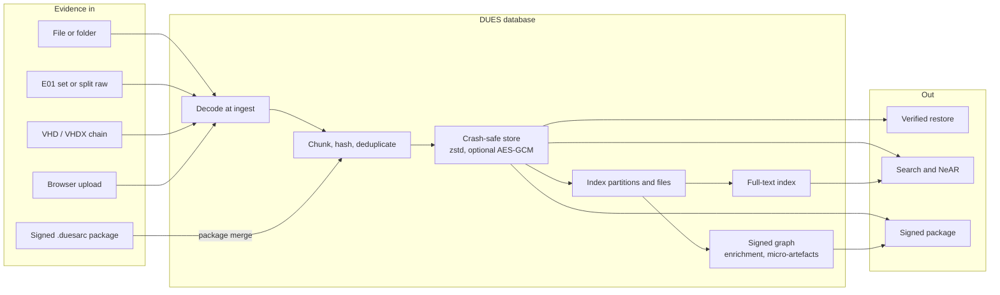
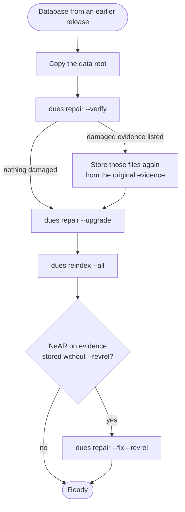
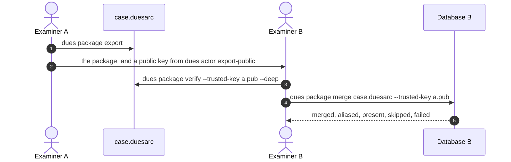

<p align="center">
  
</p>

<p align="center">
  <a href="https://github.com/aoiflux/indicer/releases/latest"></a>
  <a href="https://go.dev"></a>
  
  
  
  
</p>

<p align="center">
  <b>Deduplicated Unified Evidence Store</b><br/>
  Ingest, deduplicate, index, search, restore and compare large evidence sets.
</p>

<p align="center">
  <a href="#quick-start">Quick start</a> ·
  <a href="#installation">Installation</a> ·
  <a href="#upgrading-from-an-earlier-release">Upgrading</a> ·
  <a href="#features">Features</a> ·
  <a href="#command-reference">Commands</a> ·
  <a href="#flags">Flags</a> ·
  <a href="#docs">Docs</a>
</p>

**Version 0.4.0**, codename `<pineapple> spacebar`.

DUES is a digital forensics data platform. It stores evidence once, however
often it arrives. It decodes disk images at ingest and indexes every partition
and file inside them. Search, similarity and restore all work over the stored
chunks, and each restore is verified.

Patent information: this software has led to two derivative inventions protected
by patents 567877 and 556272 registered at the Indian Patent Office.

## What's new in 0.4.0

- **Crash-safe storage:** chunk data is synced before it is recorded, and an
  interrupted ingest is recovered or resumed. Restore verifies every chunk and
  the content hash.
- **Pure Go on every target:** there is no cgo and no libtsk. Windows, Linux
  and macOS, on amd64 and arm64, are all built from one machine.
- **Disk images decoded at ingest:** E01 sets, split raw images and VHD/VHDX
  chains are stored as the disk they hold.
- **A signed graph and signed packages:** every graph commit is signed with
  Ed25519. `dues package` moves a case between machines and merges it into
  another database.
- **Parallel work:**
  - `--store-jobs N` stores, reindexes or merges several evidence at once.
  - The server stores several uploads at once (`--upload-jobs`).
- **A safer server:**
  - It listens on loopback by default.
  - It has scoped bearer tokens.
  - Uploads resume after a break.
  - Exports are signed.
- **Flags and a config file only:** DUES reads no environment variable.

Read [Upgrading from an earlier release](#upgrading-from-an-earlier-release)
before you point 0.4.0 at an existing database.

## How it works



- **Data root** (default `~/.dues`): the database, its chunk blobs or
  containers, the graph store and the signing keys.
- **Chunks** are hashed with BLAKE3 by default, or with SHA3. They are
  compressed with zstd and, when the database has a password, encrypted with
  AES-GCM.
- **Content that is already stored** is recorded as an alias, never as a second
  copy.

## Quick start

```powershell
# Store evidence (a file, an E01 set, a VHDX, or a folder)
dues store evidence.E01 --enrich --fts --revrel

# Store into an encrypted database (the password is read from the file)
dues store evidence.E01 --dbpath ./caseA --password-file ./caseA.key

# Store with convenience presets
dues store evidence.dd --preset quick
dues store evidence.dd --quick-mode
dues store evidence.dd --performance-mode
dues store evidence.dd --low-resource-mode

# List entries
dues list

# Search (writes report.json)
dues search "invoice payment"

# Search only what the full-text index offers
dues search "invoice|receipt" --fts

# Restore by hash, verified, to a new file
dues restore <hash> --filepath restored.bin

# Near similarity from DB object
dues near in <hash> --advanced-deep --top-k 50

# Near similarity for external file
dues near out suspect.bin --explain-exact

# Backfill hierarchy enrichment in graphdb
dues enrich

# Extract micro-artefacts and export graph.html
dues micro extract --top-k 25

# Inspect, finish and verify
dues repair
dues repair --fix
dues repair --verify

# Rebuild indexes that failed or were interrupted
dues reindex --failed

# Launch TUI
dues tui
```

### Workflow recipes

```powershell
# 1) Fast triage ingest (throughput-first)
dues store evidence.E01 --preset quick --fts

# 2) Balanced case ingest (good default), ready for NeAR
dues store evidence.E01 --preset performance --enrich --fts --revrel

# 3) Low-resource ingest (laptop / constrained VM)
dues store evidence.E01 --preset low-resource --compress-level default

# 4) Search -> near -> restore investigation loop
dues search "invoice" --fts
dues near in <hash> --deep --advanced-deep --top-k 20
dues restore <hash> --filepath restored.bin

# 5) Tune heavy restore explicitly
dues restore <hash> -y 8 -U 32 -m 100 -b 128

# 6) Micro-artefact extraction workflow
dues micro extract -V -K 25
dues micro list

# 7) After a crash or a full disk
dues repair --fix --reindex-failed
dues repair --verify

# 8) A folder of evidence, four at a time
dues store ./case-folder --store-jobs 4

# 9) Hand a case to another examiner
dues package export --out case.duesarc
dues actor export-public database --out database.pub
#    ...and on their machine:
dues package merge case.duesarc --trusted-key database.pub
```

## Installation

### Download a release

Release binaries are on the
[releases page](https://github.com/aoiflux/indicer/releases), with a
`SHA256SUMS` file beside them. Each binary is static and needs no C runtime.

| Platform | amd64                          | arm64                          |
| -------- | ------------------------------ | ------------------------------ |
| Windows  | `dues-0.4.0-windows-amd64.exe` | `dues-0.4.0-windows-arm64.exe` |
| Linux    | `dues-0.4.0-linux-amd64`       | `dues-0.4.0-linux-arm64`       |
| macOS    | `dues-0.4.0-darwin-amd64`      | `dues-0.4.0-darwin-arm64`      |

Releases were renumbered in November 2026 to start at v0.1.0: v0.36, v0.37,
v0.38 and v0.39.0 are now v0.1.0, v0.2.0, v0.3.0 and v0.4.0.

To check a download, run one of these in the folder that holds the binary and
`SHA256SUMS`. Each prints `OK` for a match:

```sh
grep ' dues-0.4.0-linux-amd64$' SHA256SUMS | sha256sum -c          # Linux
grep ' dues-0.4.0-darwin-arm64$' SHA256SUMS | shasum -a 256 -c     # macOS
```

```powershell
(Get-FileHash .\dues-0.4.0-windows-amd64.exe -Algorithm SHA256).Hash.ToLower()
```

On Windows, compare the printed hash with the file's line in `SHA256SUMS`.

### Build from source

Prerequisites:
- **Go 1.26.2 or later.** `go.mod` names `toolchain go1.27.4`, so builds get its
  security fixes. The `go` command fetches it automatically, unless your Go
  installation turns automatic toolchain downloads off.
- **Windows, Linux or macOS,** on amd64 or arm64.

```bash
git clone https://github.com/aoiflux/indicer.git
cd indicer
go build -o dues .        # Windows: go build -o dues.exe .
```

### Release builds

`build.ps1` and `build.sh` build release binaries for all six targets into
`dist/`. They also write a `SHA256SUMS` file to publish beside them.

Both scripts need the release version. `dues --version` then shows it, and each
file name carries it, as in `dues-0.4.0-linux-amd64`:

```powershell
.\build.ps1 -Version 0.4.0
```

```sh
./build.sh --version 0.4.0
```

- **Version format:** `MAJOR.MINOR.PATCH`, with an optional pre-release such as
  `0.5.0-rc.1`. A leading `v` is dropped.
- **One machine for every target:** DUES is pure Go, so one machine
  cross-compiles them all.
- **Reproducible:** the builds use `-trimpath` and `-buildid=`. The same Go
  toolchain, commit and version give the same sums.
- **Subsets:** `-Targets` / `--targets` builds only some of the targets.

## Upgrading from an earlier release

> [!WARNING]
> Copy the data root before the first command that writes to it.
> - Once this release has written a database, an earlier release must not open
>   it. Downgrading is not supported.
> - DUES v0.3.0 and older refuse a graph store this release made, instead of
>   misreading it.

Databases written by earlier releases open without a migration step:
- A read-only command (list, search, restore...) reads them and writes nothing.
- The first writable command records a manifest (`dues-manifest.json`) with the
  layout it infers from the database. That layout is kept from then on.
- New evidence stored into an older database uses that database's encoding.

Some data in older databases needs action. Each step is safe to run when it
does not apply:



| What                                                                                                          | Action                                                                                                   |
| ------------------------------------------------------------------------------------------------------------- | -------------------------------------------------------------------------------------------------------- |
| Evidence that may have been damaged by earlier releases (container mode across sessions, interrupted ingests) | `dues repair --verify` lists every damaged evidence. Store those files again from the original evidence. |
| Indexes built from the raw bytes of an E01 or VHD/VHDX file, which are wrong                                  | `dues repair --upgrade` sets them aside. Store the original evidence again: it is now decoded at ingest. |
| A hierarchical (`--hierarchical`) block index                                                                 | `dues repair --upgrade` moves it into the database.                                                      |
| Indexes built before fragmented, resident, compressed and deleted files were indexed                          | `dues reindex --all` rebuilds them from the stored chunks.                                               |
| NeAR on evidence stored without `--revrel`                                                                    | `dues repair --fix --revrel` adds the reverse relations it needs.                                        |

### Behaviour that changed

- **Encryption:**
  - A database created without a password is not encrypted, and DUES says so.
    With a password, the key is derived with Argon2id and a per-database salt.
  - Quick mode no longer drops encryption.
- **Duplicate content:** storing content that is already stored records an
  alias of it instead of a second copy.
- **Restore and reports:**
  - Restore checks every chunk and the content's recorded hash.
  - Restore refuses to replace an existing file without `--force`.
  - Search, near and micro reports are written to `--out`. They refuse to
    replace an existing file without `--force`, or `--overwrite` for the micro
    graph view.
- **Server:**
  - The server listens on loopback only, unless `--listen` and a token say
    otherwise.
  - Browser uploads declare the file's `size` at `start`, and send every chunk
    with `Upload-Offset`, so an upload that is cut off can resume.
  - The earlier protocol, without a size and with appended chunks, is refused
    (`400`).
  - A `StreamFile` without `size` is refused once it passes 256 GiB.
- **Read commands** open the database read-only, so several can run at once.
  They also work on read-only media.
- **Permissions:** on Linux and macOS, a new data root is readable by its owner
  only (mode 0700 directories, 0600 chunk files).
- **`@` arguments:** an argument that starts with `@` is an argument like any
  other. `dues store @case.dd` stores the file `@case.dd`; earlier releases read
  the command line from the file `case.dd` instead.
- **Settings:**
  - Settings can be kept in a config file, `~/.config/dues/dues.json`, read on
    every run when it exists (see [Config file](#config-file)).
  - No environment variable is read (see [Environment variables](#environment-variables)).
- **Signing:**
  - Every graph commit is signed, by the database's own actor or by an examiner
    named with `--actor`. Packages are signed too.
  - The keys live in `dues.keys/` in the data root, which `dues reset` keeps.
- **Graph compaction:** the graph store is compacted when its log grows large.

### CLI migration notes

- `store --no-index` short alias is now `-N`.
- `--enable-fts` and `--enable-enrichment` are now `--fts` and `--enrich`.
- `--topk` is now `--top-k`.
- Presets are available via `--preset` and convenience aliases (`--quick-mode`,
  `--performance-mode`, `--low-resource-mode`).
- Retired flags are still accepted, but are hidden, have no effect and print a
  warning: `--hierarchical`/`-i`, `store --sync`/`-s`, `store --hocho-mode`/`-M`
  and `store --async-fio`/`-A`.
- `--password`/`-p` and `--token` are removed (see
  [Environment variables](#environment-variables)).
- `dues server` no longer listens on every interface by default; see
  [docs/SERVER_API.md](docs/SERVER_API.md).

## Features

### Ingest, dedup and storage

- **Deduplication:** chunk-level, with BLAKE3 by default or SHA3, and zstd
  compression.
- **Optional encryption** with AES-GCM. Each stored chunk is bound to its own
  key, so a chunk read from the wrong place is an error, never wrong content.
- **Storage modes:** file mode (one blob per chunk), or container mode
  (`--container`, chunks packed into framed container files).
- **Crash-safe storage:** chunk data is synced before it is recorded. An
  interrupted ingest is recovered or resumed at the next writable open.
- **Idempotent ingest:** storing content that is already stored records an
  alias.
- **Disk images decoded at ingest:**
  - E01 sets, split raw images (`.001`, `.002`...) and VHD/VHDX disks,
    including snapshot chains, are stored as the disk image they hold.
  - An E01 is checked against the MD5/SHA-1 its set recorded.
    `--require-verified` refuses one that does not match.
- **Folders:**
  - A folder is stored file by file. Links and special files are skipped and
    reported.
  - `--store-jobs N` stores N evidence at once. The jobs are fitted to the
    machine's memory and the database's chunk size.
- **Repair and reindex:** `dues repair` finishes interrupted ingests, verifies
  stored data and upgrades older databases. `dues reindex` rebuilds indexes
  from the stored chunks.

### Image parsing

- **Pure Go on every target,** through the aoiflux libraries: no cgo and no C
  toolchain.
- **Partition tables:** MBR, GPT, APM, BSD and Sun. A device with no table is
  read as one volume.
- **Filesystems:** FAT12/16/32, exFAT, NTFS, ext2/3/4, XFS, classic HFS and
  HFS+. BitLocker, LUKS, APFS, ReFS, btrfs, LVM2 and swap are recognised and
  reported, not parsed.
- **Real file layouts:** every file is indexed with its real layout. This
  covers:
  - fragmented and sparse files, and unwritten extents;
  - resident and inline data;
  - NTFS alternate data streams (as `path:stream`);
  - compressed content, which is decoded and stored.
- **Deleted files** are recovered where the filesystem allows, with flags for
  how far the recovered content can be trusted.
- **Damaged or hostile images** cannot crash DUES:
  - parser panics are contained;
  - sizes read from the image are bounded;
  - problems are reported per partition.

### Search and ranking

- **What is searched:** every stored evidence, partition and indexed file is
  searched as its own bytes. Search is case-insensitive, and finds matches that
  span chunk boundaries.
- **Query syntax:** `a b` needs both terms, `a|b` either, and `"a b"` is one
  phrase.
- **Ranking:** BM25-driven, with an occurrence boost (`--rank-alpha`).
- **`--fts`** searches only the files a full-text index offers, and the report
  says what that leaves out.
- **The report** (`report.json`, or `--out`) counts matches per level and names
  any object that could not be read.

### Near similarity (NeAR)

- **Two directions:** `near in` compares an object already stored in DUES;
  `near out` compares an external file against DUES content.
- **Attribution:** chunk matches are attributed to the most specific object
  holding them. Confidence is the share of the object's chunks that match.
- **Deeper matching:** `--deep` adds similar-chunk matching through chunk
  SimHash signatures (`store --simhash`). `--advanced-deep` re-ranks by
  full-file SimHash.
- **Reverse relations:** NeAR needs them. Store with `--revrel`, or add them
  with `dues repair --fix --revrel`.

### Enrichment and micro-artefacts

- **Hierarchy:** `dues enrich` writes the evidence, partition and file
  hierarchy to a graph store, with entropy and type information.
- **Micro-artefacts:** `dues micro extract` finds them in indexed files:
  - URLs, IP addresses, e-mail addresses, domains and hashes;
  - key-value pairs, log lines and timestamps;
  - scheduled tasks, services and browser artefacts;
  - Windows event records;
  - PE, registry and EVTX metadata.

  PE, ELF and PDF files are parsed for their text too. Hostile input is parsed
  with bounds.
- **Graph view:** an interactive HTML view of the graph (`graph.html`, or
  `--out`).
- **Signing:** every graph commit is signed with Ed25519 and checked on open.
  `dues actor` manages the signing actors and their keys.
- **Compaction:** `dues graph compact` folds the graph's log into its image.
  Commands that write the graph do it themselves once the log is large.
  `dues graph status` describes the store.

### Packages and merge

A database travels as one `.duesarc` file, signed by the database's actor:



- **Commands:** `dues package export|inspect|verify|import|merge`.
- **Verify:** `--deep` reads every evidence back. `--trusted-key` requires a
  signature by that public key.
- **Merge:**
  - It copies a package's evidence into another database, in that database's
    layout.
  - A rerun reports every item as present. An interrupted merge resumes.
- **Private keys** (`*.key`) never enter a package.

### API, server and browser uploads

- **Protocols:** Connect, gRPC and gRPC-Web on port 50051. The server answers
  on 127.0.0.1 and [::1] only, unless `--listen` says otherwise.
- **Tokens:**
  - A non-loopback address needs a bearer token of at least 32 characters
    (`--token-file`). Once set, a token is required on every request except the
    health checks.
  - A `#dues-tokens v1` file gives several tokens, each with a label and the
    scopes `read`, `upload` or `export`.
  - Traffic is plain HTTP. Use a TLS proxy or an SSH tunnel for remote clients.
- **Browser access:** pages from loopback origins, and from `--cors-origin`
  origins, may call the server. Other origins are refused.
- **Listings** of evidence, partitions and indexed files are paged, with chunk
  maps.
- **Resumable browser uploads:** each is checked against the client's hash
  before it is stored. Up to `--upload-jobs` are stored at once (default 1):
  - POST /web/upload/start
  - POST /web/upload/chunk (with `Upload-Offset`)
  - POST /web/upload/status
  - POST /web/upload/abort
  - POST /web/upload/finalize
- **Package exports:**
  - They need a token with the `export` scope, and run one at a time.
  - Each is kept `--export-keep-hours` (default 24) in `--export-dir` (default
    the data root's `exports/`).
  - The database is paused while it is copied. Reads are refused (503,
    Retry-After: 5) until the package is written.
  - Routes:
    - POST /web/export/start
    - POST /web/export/status
    - POST /web/export/cancel
    - GET /web/export/download/{id} (with the `Authorization` header)
- **Health checks** at GET /healthz and GET /readyz.
- **Protocol reference:** [docs/SERVER_API.md](docs/SERVER_API.md).

### TUI and operator workflow

- **Screens:** a Bubble Tea v2 based TUI with store, list, search, restore,
  NeAR, statistics, micro-artefact and reset screens.
- **Jobs:**
  - Actions run as cancellable jobs behind the screen (`ctrl+x` cancels).
  - Quitting while one runs asks first, and DUES waits for the jobs before it
    closes the database.
  - If a job does not stop, the database is left unclosed, for badger to
    recover at its next open.
- **Safety prompts:** reset asks for the database folder's name, and a restore
  over an existing file asks first. The database's chunk layout is shown, not
  changed.
- **Guide:** [docs/TUI_QUICKSTART.md](docs/TUI_QUICKSTART.md).

### Operations

- **Logs:** per-process NDJSON logs with secrets redacted, and a crash file for
  every crash. A logging failure never stops a command.
- **Stopping:** Ctrl-C and SIGTERM stop at a safe point, and the exit codes are
  stable.
- **Disk space:** DUES keeps 128 MiB free on the database's volume, and stops
  an ingest before the disk fills.
- **Traces:** `--trace FILE` writes a Go execution trace, with one task per
  evidence and a region per phase.
- **Runbook:** [docs/OPERATIONS.md](docs/OPERATIONS.md).

### Security model

- **Secrets** are never taken on the command line or from the environment:
  - passwords come from `--password-file` or `--password-stdin`;
  - tokens come from `--token-file`.
- **The data root** is readable by its owner only on Linux and macOS. On
  Windows, access comes from the folder's ACLs.
- **The server** answers on loopback unless told otherwise. A non-loopback
  address needs a token, and each token carries only its own scopes.
- **Signatures:**
  - A signature is only as strong as the custody of the data root.
  - In an unencrypted database, the database actor's key is stored
    unprotected.
  - Only a `--trusted-key` held outside the root is a trust anchor.

## Command reference

| Command                                                | What it does                                              |
| ------------------------------------------------------ | --------------------------------------------------------- |
| `dues store FILE\|FOLDER`                              | Store evidence                                            |
| `dues list`                                            | List the stored evidence                                  |
| `dues search QUERY`                                    | Search everything stored                                  |
| `dues restore HASH`                                    | Restore content, verified                                 |
| `dues near in HASH` / `dues near out FILE`             | Near similarity for stored content or an external file    |
| `dues stats`                                           | Database statistics                                       |
| `dues repair [--fix] [--verify] [--upgrade]`           | Finish, verify and upgrade                                |
| `dues reindex ID\|HASH... \| --failed \| --all`        | Rebuild indexes from the stored chunks                    |
| `dues enrich`                                          | Write the hierarchy to the graph                          |
| `dues micro extract` / `dues micro list`               | Find and list micro-artefacts                             |
| `dues package export\|inspect\|verify\|import\|merge`  | Move a database as a signed package                       |
| `dues graph compact\|status`                           | Compact or describe the graph store                       |
| `dues actor create\|list\|export-public\|rotate\|revoke` | Manage signing actors and their keys                    |
| `dues server`                                          | Serve the API and browser uploads                         |
| `dues tui`                                             | Launch the TUI                                            |
| `dues version`                                         | Print the version                                         |
| `dues config`                                          | Print every setting, its value and its source             |
| `dues reset`                                           | Delete the database, and nothing else in the data root    |

Run `dues help <command>` for a command's flags and examples.

**Exit codes:**
- `0`: success;
- `1`: failure;
- `2`: a usage error, or done with a warning;
- `70`: internal error;
- `130`/`143`: interrupted.

See [docs/OPERATIONS.md](docs/OPERATIONS.md).

## Flags

### Global

| Flag                                                      | Short | What it does                                                                                                     |
| --------------------------------------------------------- | ----- | ---------------------------------------------------------------------------------------------------------------- |
| `--config FILE`                                           |       | Read settings from this config file (default `~/.config/dues/dues.json`, when it exists)                         |
| `--no-config`                                             |       | Read no config file                                                                                              |
| `--dbpath`                                                | `-d`  | Data root (default `~/.dues`)                                                                                    |
| `--log-dir`                                               |       | Directory for log and crash files                                                                                |
| `--temp-dir`                                              |       | Directory for temporary files (default `/tmp`, or `AppData\Local\Temp` under the user's profile on Windows)      |
| `--debug`                                                 |       | Write debug entries to the log                                                                                   |
| `--trace FILE`                                            |       | Write a Go execution trace of the run to FILE, which must not exist yet, for `go tool trace`                     |
| `--graph-compact auto\|never`                             |       | After a command that wrote the graph, compact it when its log has passed 1 GiB or 5 million records (default auto) |
| `--password-file`                                         |       | Read the password from the first line of a file                                                                  |
| `--password-stdin`                                        |       | Read the password from standard input                                                                            |
| `--actor NAME`                                            |       | Sign the graph commits of a command that writes them as this actor, not the database's own                       |
| `--actor-key-password-file`, `--actor-key-password-stdin` |       | The passphrase of that actor's key                                                                               |
| `--chonksize`                                             | `-c`  | Chunk size in KB of a new database (default 256)                                                                 |
| `--low`                                                   | `-l`  | Low-resource mode                                                                                                |
| `--quick`                                                 | `-q`  | A new database without table compression; encryption is unchanged                                               |
| `--container`                                             | `-x`  | Container storage for a new database                                                                             |
| `--compress-level`                                        | `-z`  | `fast`, `default` or `best`                                                                                      |
| `--preset`                                                | `-P`  | Apply a convenience preset: `quick`, `performance` or `low-resource`                                             |
| `--quick-mode`                                            | `-Q`  | Alias for `--preset quick`                                                                                       |
| `--performance-mode`                                      | `-o`  | Alias for `--preset performance`                                                                                 |
| `--low-resource-mode`                                     | `-L`  | Alias for `--preset low-resource`                                                                                |

Chunk size, hash algorithm, storage and encryption are fixed when a database is
created. A flag that contradicts an existing database is an error.

### Output

Results (JSON, reports, help) go to stdout. The run header, progress, notes,
warnings and errors go to stderr, so `dues list | jq` reads pure JSON. On a
terminal, DUES shows colour and a live progress display; on a pipe, it writes
plain lines with no escape codes.

`dues --version` (or `-v`) prints one line, for scripts and bug reports:
`DUES 0.4.0+74431db (<pineapple> spacebar) - Deduplicated Unified Evidence Store`.

| Flag        | What it does                                                                                                                         |
| ----------- | ------------------------------------------------------------------------------------------------------------------------------------ |
| `--color`   | `auto` (default: 256 colours on a terminal, none on a pipe), `always`, `never`, `ansi` (the terminal theme's 16 colours only) or `truecolor` |
| `--plain`   | No colour, ASCII only, no redraw or animation (for screen readers, logs and terminals without Unicode)                               |
| `--ci`      | Behave as if no terminal is attached, for CI logs                                                                                    |
| `--theme`   | The terminal's background: `auto` (default), `dark` or `light`. Under `auto` the TUI asks the terminal for it                        |
| `--taskbar` | Show progress on the terminal's tab and taskbar (Windows Terminal, ConEmu)                                                           |
| `--no-fun`  | No surprise extras after long commands (the hidden commands still run when asked for by name)                                        |

See [docs/CLI_UX.md](docs/CLI_UX.md).

### Store

| Flag                                  | Short      | What it does                                                                          |
| ------------------------------------- | ---------- | ------------------------------------------------------------------------------------- |
| `--no-index`                          | `-N`       | Store without indexing                                                                |
| `--require-verified`                  |            | Refuse an E01 whose stored MD5/SHA-1 does not match                                   |
| `--fts`                               | `-F`       | Build the full-text index                                                             |
| `--enrich`                            | `-E`       | Write hierarchy metadata to the graph store                                           |
| `--hash-algo`                         | `-g`       | Chunk hash of a new database: `sha3` or `blake3`                                      |
| `--hash-strategy`                     | `-S`       | `sync`, `async` or `hocho`                                                            |
| `--pipeline`                          | `-Y`       | `batch-owner` or `staged`                                                             |
| `--simhash`                           | `-H`       | Compute chunk SimHash signatures during ingest                                        |
| `--revrel`                            | `-R`       | Persist reverse relations during ingest (NeAR needs them)                             |
| `--store-workers`, `--store-queue`    | `-w`, `-W` | Override ingest pipeline tuning                                                       |
| `--store-jobs N`                      |            | Evidence of a folder stored at once (default 1; 0 = chosen for this machine)          |
| `--io-engine`, `--io-uring-queue-depth` | `-I`, `-j` | Write engine (io-uring on Linux)                                                    |

### Restore

| Flag                                   | Short      | What it does                                                  |
| -------------------------------------- | ---------- | ------------------------------------------------------------- |
| `--filepath`                           | `-f`       | Output path                                                   |
| `--force`                              |            | Replace an existing output file                               |
| `--verify`                             |            | `full` (default), `chunks` or `off`                           |
| `--verify-ewf`                         |            | Also check a restored E01 against its stored MD5/SHA-1        |
| `--restore-workers`, `--restore-queue` | `-y`, `-U` | Pipeline tuning                                               |
| `--restore-buffer-mb`                  | `-b`       | Write buffer sizing                                           |

### Search and near

| Command | Flag                  | Short | What it does                                        |
| ------- | --------------------- | ----- | --------------------------------------------------- |
| search  | `--rank-alpha`        | `-r`  | Occurrence boost weighting                          |
| search  | `--fts`               | `-F`  | Search only the files the full-text index offers    |
| near    | `--deep`              | `-e`  | Partial chunk matching                              |
| near    | `--advanced-deep`     | `-a`  | Phase-2 full-file SimHash rerank                    |
| near    | `--top-k`             | `-k`  | Top-K candidates for the phase-2 rerank             |
| near    | `--explain-exact`     | `-t`  | Force chunk drilldown for an exact out-file match   |
| both    | `--out`, `--force`    |       | Report path, and replacing an existing report       |

### Repair and reindex

- `repair --fix`, `-J`: finish what interrupted ingests left.
- `repair --fix --reindex-failed`: also rebuild failed or interrupted indexes.
- `repair --fix --revrel`: add the reverse relations NeAR needs.
- `repair --verify`: read back every chunk and check its hash.
- `repair --upgrade [--yes]`: move a legacy block index into the database. It
  also sets aside indexes of raw-stored E01 or VHD/VHDX evidence.
- **Repair output:** repair prints one JSON document on stdout, with a section
  for each step that ran. Each step's lines and the `--upgrade` question go to
  stderr (see [OPERATIONS.md](docs/OPERATIONS.md)).
- `reindex --failed | --all | ID...`: rebuild indexes from the stored chunks.
  - `--source` reads one evidence from its original file instead.
  - `--store-jobs N` reindexes N at once.

### Packages, graph and actors

- **`package export`:**
  - `--without-derived` leaves out the full-text index and graph;
  - `--split-size-mb N` writes parts of N MiB.
- **`package verify --deep`** also reads every evidence back from a copy.
- **`package verify|import|merge --trusted-key FILE`** requires a signature by
  this public key (`dues actor export-public`).
- **`package merge PACKAGE`** copies a package's evidence into this database, in
  its layout:
  - `--source-password-file` or `--source-password-stdin` unlocks the
    package's database;
  - `--allow-plaintext` lets an encrypted one into an unencrypted database;
  - `--stage-dir DIR` moves the copy;
  - `--store-jobs N` merges N at once.
- **`graph compact --require-signed`** refuses unsigned commits from then on.
- **`actor create|rotate NAME --actor-key-password-file FILE`** makes an actor,
  or gives it a new key.
- **`actor revoke KEY-ID [--reason TEXT]`** stops a key from signing.

### Server

| Flag                                | What it does                                                                                                   |
| ----------------------------------- | -------------------------------------------------------------------------------------------------------------- |
| `--listen HOST:PORT`                | Serve on this address (repeatable). A non-loopback address needs a token                                       |
| `--token-file PATH`                 | Require a bearer token: one token on its first line, or a `#dues-tokens v1` file of `<token> <scopes> <label>` lines |
| `--cors-origin ORIGIN`              | Also let pages from this origin call the server, as `scheme://host[:port]` (repeatable)                        |
| `--upload-jobs N`                   | Uploads stored at once (default 1; 0 = chosen for this machine)                                                |
| `--export-dir DIR`                  | Where export packages are written (default the data root's `exports/`)                                         |
| `--export-keep-hours N`             | How long a written export is kept (default 24)                                                                 |
| `--export-drain-timeout D`          | How long an export waits for the uploads being stored, such as `90s` or `10m`                                  |

### Config file

Settings an operator wants on every run go in `~/.config/dues/dues.json`, in
the account's home directory, on every system:
- DUES reads it when it exists.
- `--config FILE` reads another file, which must exist. `--no-config` reads
  none.

The file is one JSON object whose keys are flag names, exactly as typed. A
command's own settings go in an object named after it, and apply to that
command only. The exception: `store` and `restore` settings also tune the TUI's
stores and restores. Paths must be absolute.

```json
{
  "theme": "light",
  "log-dir": "D:\\dues\\logs",
  "dbpath": "D:\\cases\\c42",
  "password-file": "D:\\keys\\c42.key",
  "preset": "performance",
  "store": { "pipeline": "staged", "store-workers": 8 },
  "server": {
    "listen": ["127.0.0.1:50051"],
    "token-file": "D:\\keys\\server.token"
  }
}
```

- **Keys:**
  - global: `color`, `plain`, `ci`, `no-fun`, `theme`, `taskbar`, `log-dir`,
    `temp-dir`, `debug`, `dbpath`, `password-file`, `preset`,
    `compress-level`, `low`, `graph-compact`, `actor`,
    `actor-key-password-file`;
  - `store`: `pipeline`, `hash-strategy`, `io-engine`, `io-uring-queue-depth`,
    `store-workers`, `store-queue`, `store-jobs`;
  - `restore`: `restore-workers`, `restore-queue`, `restore-buffer-mb`;
  - `server`: `listen`, `token-file`, `cors-origin`, `upload-jobs`,
    `export-dir`, `export-keep-hours`, `export-drain-timeout`.
- **Not keys:**
  - the layout of a new database (chunk size, container, hash algorithm,
    quick);
  - choices for one run (`--fix`, `--force`, `--out`...);
  - the password itself.
- **Precedence:** a flag wins over the file, and the file over the default. A
  preset on the command line replaces the file's `preset`, `compress-level`
  and `low`.
- **Passwords:** the file's `password-file` applies unless `--password-file` or
  `--password-stdin` is given. New databases are then created encrypted.
- **Errors:** a file that cannot be used stops every command with exit 2,
  naming the file, line and column. That covers bad JSON, an unknown or
  repeated key, and a bad value. Fix the file or run with `--no-config`.
- **Ownership:** on Linux and macOS, the file must belong to you or root, and
  neither its group nor others may write it.

`dues config` prints every setting with its value and source (flag, config or
default) as JSON. `dues help config` describes the file. The compression
command reads `~/.config/dues/compression.json` the same way, with the keys
`log-dir` and `temp-dir`.

### Environment variables

DUES reads no environment variables. Every setting is a flag or a key in the
config file, so a run does the same whatever the shell holds. Each run logs its
settings and where each came from.

<details>
<summary>The variables earlier releases read, and what replaces them</summary>

| Earlier                                                         | Now                                                        |
| --------------------------------------------------------------- | ---------------------------------------------------------- |
| `DUES_PASSWORD`, `DUES_TOKEN`                                   | `--password-file`, `--password-stdin` or `--token-file`    |
| `DUES_LOG_DIR`, `DUES_DEBUG`                                    | `--log-dir` and `--debug`                                  |
| `DUES_COLOR`, `DUES_PLAIN`, `DUES_NO_FUN`, `DUES_THEME`         | `--color`, `--plain`, `--no-fun` and `--theme`             |
| `NO_COLOR`, `FORCE_COLOR`, `CLICOLOR_FORCE`, `TERM`, `CI` and the other CI variables | `--color`, `--plain` and `--ci`       |

</details>

`--password`/`-p` and `--token` were removed as well, because a secret on the
command line is visible to other users of the machine. Passing one is a usage
error that names its replacement.

## Compression product

The compression command and its FFI library share DUES's `.duesarc` format.
The FFI build mode defaults to `auto`:
- Windows targets use `c-shared` (DLL);
- other targets use `c-archive` (a static `.a`).

The FFI library needs cgo and a C toolchain for its target. The compression
command does not.

<details>
<summary>Build commands</summary>

```powershell
# Windows compression CLI artifact
./build-compression.ps1 -Mode cli -Targets windows/amd64

# Windows compression CLI + FFI c-archive artifacts
./build-compression.ps1 -Mode all -FfiBuildMode c-archive -Targets windows/amd64

# Windows compression FFI shared library (Flutter-friendly)
./build-compression.ps1 -Mode ffi -FfiBuildMode c-shared -Targets windows/amd64
```

```bash
# Linux compression CLI artifact
./build-compression.sh --mode cli --targets linux/amd64

# Linux compression CLI + FFI c-archive artifacts
./build-compression.sh --mode all --ffi-build-mode c-archive --targets linux/amd64

# Linux compression FFI shared library (Flutter-friendly)
./build-compression.sh --mode ffi --ffi-build-mode c-shared --targets linux/amd64
```

Product wrapper builds (routes to product-specific scripts):

```powershell
# Build compression CLI using root wrapper
./build-product.ps1 -Product compression -Mode cli -Targets windows/amd64

# Build compression FFI shared library using root wrapper
./build-product.ps1 -Product compression -Mode ffi -FfiBuildMode c-shared -Targets windows/amd64
```

```bash
# Build compression CLI using root wrapper
./build-product.sh --product compression --mode cli --targets linux/amd64

# Build compression FFI shared library using root wrapper
./build-product.sh --product compression --mode ffi --ffi-build-mode c-shared --targets linux/amd64
```

</details>

FFI ABI for Flutter and native callers:
- **Build output:** a library and a C header in `dist/compression`. Example
  Windows output:
  - `dues_engine-windows-amd64.dll`
  - `dues_engine-windows-amd64.h`
- **Exported C functions,** from the generated header:
  - `char* DuesDispatchJSON(char* requestJSON)`
  - `char* DuesShutdown(long long timeout_ms)`
  - `void DuesFreeString(char* ptr)`
- **Caller duties:**
  - Free every response buffer returned by `DuesDispatchJSON` and
    `DuesShutdown`, by calling `DuesFreeString`.
  - Call `DuesShutdown` before exiting.

Requests, error codes, limits and the `.duesarc` format are described in
[docs/COMPRESSION_ABI_REFERENCE.md](docs/COMPRESSION_ABI_REFERENCE.md).

## Output artefacts

| Artefact                 | Written by                                                     |
| ------------------------ | -------------------------------------------------------------- |
| `report.json`            | `search` (or `search --out`)                                   |
| `near_report.json`       | `near in\|out` (or `--out`)                                    |
| `graph.html`             | `micro extract`, in the working directory (or `--out`)         |
| `blob/` in the data root | Deduplicated chunk blobs or containers                         |
| `dues.keys/` in the data root | Signing keys; `dues reset` keeps them                     |
| `*.duesarc`              | `package export`, and server exports in `exports/`             |

## Docs

| Document                                                             | Covers                                                                 |
| -------------------------------------------------------------------- | ---------------------------------------------------------------------- |
| [OPERATIONS.md](docs/OPERATIONS.md)                                  | The data root, crashes, signals, logs, compaction, keys, packages      |
| [CLI_UX.md](docs/CLI_UX.md)                                          | Output, colour, progress and the terminal                              |
| [SERVER_API.md](docs/SERVER_API.md)                                  | The server's RPCs, uploads, exports and tokens                         |
| [TUI_QUICKSTART.md](docs/TUI_QUICKSTART.md)                          | The TUI                                                                |
| [COMPRESSION_ABI_REFERENCE.md](docs/COMPRESSION_ABI_REFERENCE.md)    | The compression FFI and the `.duesarc` format                          |

## Contributing

Issues and pull requests are welcome. Every change must pass the verify gate:
- on Windows: `pwsh -NoProfile -File scripts/verify.ps1 -Long` (its Linux part
  runs in WSL);
- on Linux: `scripts/verify.sh`.

## License

MIT.
