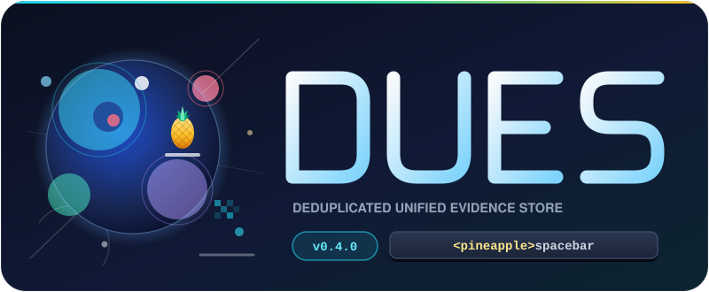

# DUES - Deduplicated Unified Evidence Store

<p align="center">
  
</p>

[](https://golang.org)
[](https://github.com/aoiflux/indicer)


DUES is a digital forensics data platform for ingesting, deduplicating,
indexing, searching, restoring, and comparing large evidence sets.

Version: 0.39 Codename: <pineapple> spacebar

Patent information: this software has led to two derivative inventions protected
by patents 567877 and 556272 registered at the Indian Patent Office.

## Upgrading from an earlier release

Databases written by earlier releases open without a migration step:
- A read-only command (list, search, restore...) reads them and writes nothing.
- The first writable command records a manifest (`dues-manifest.json`) with the
  layout it infers from the database. That layout is kept from then on.
- New evidence stored into an older database uses that database's encoding.

Some data in older databases needs action:

| What | Action |
|---|---|
| Evidence that may have been damaged by earlier releases (container mode across sessions, interrupted ingests) | `dues repair --verify` lists every damaged evidence. Store those files again from the original evidence. |
| Indexes built from the raw bytes of an E01 or VHD/VHDX file, which are wrong | `dues repair --upgrade` sets them aside. Store the original evidence again: it is now decoded at ingest. |
| A hierarchical (`--hierarchical`) block index | `dues repair --upgrade` moves it into the database. |
| Indexes built before fragmented, resident, compressed and deleted files were indexed | `dues reindex --all` rebuilds them from the stored chunks. |
| NeAR on evidence stored without `--revrel` | `dues repair --fix --revrel` adds the reverse relations it needs. |

Do not open a database with an earlier release once this one has written to it.
Downgrading is not supported.

Behaviour that changed:
- A database created without a password is not encrypted, and DUES says so.
  With a password, the key is derived with Argon2id and a per-database salt.
- Quick mode no longer drops encryption.
- Storing content that is already stored records an alias of it instead of a
  second copy.
- Restore checks every chunk and the content's recorded hash, and refuses to
  replace an existing file without `--force`.
- Search, near and micro reports are written to `--out` and refuse to replace
  an existing file without `--force` (or `--overwrite` for the micro graph
  view).
- The server listens on loopback only, unless `--listen` and a token say
  otherwise.
- Browser uploads declare the file's `size` at `start` and send every chunk
  with `Upload-Offset`, so an upload that is cut off can resume. The earlier
  protocol, without a size and with appended chunks, is refused (`400`). A
  `StreamFile` without `size` is refused once it passes 256 GiB.
- Read commands open the database read-only, so several can run at once, and
  they work on read-only media.
- On Linux and macOS a new data root is readable by its owner only (mode 0700
  directories, 0600 chunk files).
- An argument that starts with `@` is an argument like any other:
  `dues store @case.dd` stores the file `@case.dd`. Earlier releases read the
  command line from the file `case.dd` instead.
- Settings can be kept in a config file, `~/.config/dues/dues.json`, read on
  every run when it exists (see [Config file](#config-file)).
- Every graph commit is signed, by the database's own actor or by an examiner
  named with `--actor`, and packages are signed too. The keys live in
  `dues.keys/` in the data root, which `dues reset` keeps.
- The graph store is compacted when its log grows large. DUES v0.39 and older
  refuse a graph store this release made, instead of misreading it.

## Feature highlights

### 1) Ingest, dedup, and storage

- Chunk-level deduplication. Chunks are hashed with BLAKE3 by default, or SHA3,
  and compressed with zstd.
- Optional encryption with AES-GCM. Each stored chunk is bound to its own key,
  so a chunk read from the wrong place is an error, never wrong content.
- File mode (one blob per chunk) or container mode (`--container`, chunks
  packed into framed container files).
- Crash-safe storage: chunk data is synced before it is recorded, and an
  interrupted ingest is recovered or resumed at the next writable open.
- Idempotent ingest: storing content that is already stored records an alias.
- E01 sets, split raw images (`.001`, `.002`...) and VHD/VHDX disks, including
  snapshot chains, are decoded at ingest and stored as the disk image they
  hold. An E01 is checked against the MD5/SHA-1 its set recorded.
  `--require-verified` refuses one that does not match.
- Folders are stored file by file; links and special files are skipped and
  reported.
- `dues repair` finishes interrupted ingests, verifies stored data and upgrades
  older databases. `dues reindex` rebuilds indexes from the stored chunks.

### 2) Image parsing

- Pure Go, on every target, through the aoiflux libraries: no cgo and no C
  toolchain.
- Partition tables: MBR, GPT, APM, BSD and Sun. A device with no table is
  read as one volume.
- Filesystems: FAT12/16/32, exFAT, NTFS, ext2/3/4, XFS, classic HFS and HFS+.
  BitLocker, LUKS, APFS, ReFS, btrfs, LVM2 and swap are recognised and
  reported, not parsed.
- Every file is indexed with its real layout: fragmented and sparse files,
  unwritten extents, resident and inline data, NTFS alternate data streams
  (as `path:stream`), and compressed content, which is decoded and stored.
- Deleted files are recovered where the filesystem allows, with flags for how
  far the recovered content can be trusted.
- A damaged or hostile image cannot crash DUES: parser panics are contained,
  sizes read from the image are bounded, and problems are reported per
  partition.

### 3) Search and ranking

- Every stored evidence, partition and indexed file is searched as its own
  bytes, case-insensitively, including matches that span chunk boundaries.
- `a b` needs both terms, `a|b` either, and `"a b"` is one phrase.
- BM25-driven ranking, with an occurrence boost (`--rank-alpha`).
- `--fts` searches only the files a full-text index offers, and the report
  says what that leaves out.
- The report (`report.json`, or `--out`) counts matches per level and names
  any object that could not be read.

### 4) Near similarity

- `near in`: compare an object already stored in DUES.
- `near out`: compare an external file against DUES content.
- Chunk matches are attributed to the most specific object holding them, and
  confidence is the share of the object's chunks that match.
- `--deep` adds similar-chunk matching through chunk SimHash signatures
  (`store --simhash`), and `--advanced-deep` re-ranks by full-file SimHash.
- NeAR needs reverse relations: store with `--revrel`, or add them with
  `dues repair --fix --revrel`.

### 5) Enrichment and micro-artefacts

- `dues enrich` writes the evidence, partition and file hierarchy to a graph
  store, with entropy and type information.
- `dues micro extract` finds micro-artefacts in indexed files: URLs, IP
  addresses, e-mail addresses, domains and hashes; key-value pairs, log lines
  and timestamps; scheduled tasks, services and browser artefacts; Windows
  event records; PE, registry and EVTX metadata. PE, ELF and PDF files are
  parsed for their text too. Hostile input is parsed with bounds.
- An interactive HTML view of the graph (`graph.html`, or `--out`).
- Every graph commit is signed with Ed25519 and checked on open. `dues actor`
  manages the signing actors and their keys.
- `dues graph compact` folds the graph's log into its image, and commands that
  write the graph do it themselves once the log is large; `dues graph status`
  describes the store.

### 6) API, server, and browser upload path

- Connect, gRPC and gRPC-Web on port 50051, served on 127.0.0.1 and [::1]
  only unless `--listen` says otherwise.
- A non-loopback address needs a bearer token of at least 32 characters
  (`--token-file`). Once set, a token is required on every request but the
  health checks. A `#dues-tokens v1` file gives several tokens, each with a
  label and the scopes `read`, `upload` or `export`. Traffic is plain HTTP;
  use a TLS proxy or an SSH tunnel for remote clients.
- Browser pages from loopback origins, and from `--cors-origin` origins, may
  call the server; other origins are refused.
- Paged listings of evidence, partitions and indexed files, with chunk maps.
- Resumable browser uploads, checked against the client's hash before they
  are stored, up to `--upload-jobs` at once (default 1):
  - POST /web/upload/start
  - POST /web/upload/chunk (with `Upload-Offset`)
  - POST /web/upload/status
  - POST /web/upload/abort
  - POST /web/upload/finalize
- Package exports for a token with the `export` scope, one at a time, kept
  `--export-keep-hours` (default 24) in `--export-dir` (default the data
  root's `exports/`). The database is paused while it is copied, so reads
  are refused (503, Retry-After: 5) until the package is written:
  - POST /web/export/start
  - POST /web/export/status
  - POST /web/export/cancel
  - GET /web/export/download/{id} (with the `Authorization` header)
- Health checks at GET /healthz and GET /readyz.
- The protocol is described in [docs/SERVER_API.md](docs/SERVER_API.md).

### 7) TUI and operator workflow

- Bubble Tea v2 based TUI with store, list, search, restore, NeAR,
  statistics, micro-artefact and reset screens.
- Actions run as cancellable jobs behind the screen (`ctrl+x` cancels).
  Quitting while one runs asks first, and DUES waits for the jobs before it
  closes the database. If a job does not stop, the database is left unclosed
  for badger to recover at its next open.
- Reset asks for the database folder's name, and a restore over an existing
  file asks first; the database's chunk layout is shown, not changed.
- See [docs/TUI_QUICKSTART.md](docs/TUI_QUICKSTART.md).

### 8) Operations

- Per-process NDJSON logs with secrets redacted, and a crash file for every
  crash. A logging failure never stops a command.
- Ctrl-C and SIGTERM stop at a safe point; the exit codes are stable.
- DUES keeps 128 MiB free on the database's volume, and stops an ingest before
  the disk fills.
- `dues package` exports a database to a signed, verifiable `.duesarc` and
  imports it elsewhere; `--trusted-key` checks who signed it.
- See [docs/OPERATIONS.md](docs/OPERATIONS.md).

## Installation

### Prerequisites

- Go 1.26.2 or later. `go.mod` names `toolchain go1.27.3`, which the `go`
  command fetches automatically (`GOTOOLCHAIN=auto`, the default) so builds
  get its security fixes.
- Windows, Linux, or macOS, on amd64 or arm64.

### Build

```bash
git clone https://github.com/aoiflux/indicer.git
cd indicer
go build -o dues .
```

Windows users may prefer:

```powershell
go build -o dues.exe .
```

`build.ps1` and `build.sh` build release binaries for all six targets into
`dist/`, with a `SHA256SUMS` file of their sums to publish beside them. Both
need the release version, which `dues --version` then shows and each file
name carries, such as `dues-0.39.0-linux-amd64`:

```powershell
.\build.ps1 -Version 0.39.0
```

```sh
./build.sh --version 0.39.0
```

The version is `MAJOR.MINOR.PATCH`, with an optional pre-release such as
`0.40.0-rc.1`; a leading `v` is dropped. DUES is pure Go, so one machine
cross-compiles every target. The builds are reproducible (`-trimpath`,
`-buildid=`): the same Go toolchain, commit and version give the same sums.

To check a download, run one of these in the folder that holds the binary and
`SHA256SUMS`. Each prints `OK` for a match:

```sh
grep ' dues-0.39.0-linux-amd64$' SHA256SUMS | sha256sum -c          # Linux
grep ' dues-0.39.0-darwin-arm64$' SHA256SUMS | shasum -a 256 -c     # macOS
```

```powershell
(Get-FileHash .\dues-0.39.0-windows-amd64.exe -Algorithm SHA256).Hash.ToLower()
```

On Windows, compare the printed hash with the file's line in `SHA256SUMS`.

Compression product specific builds:

Note: FFI build mode defaults to `auto`:

- Windows targets use `c-shared` (DLL)
- Non-Windows targets use `c-archive` (static `.a`)

The FFI library needs cgo and a C toolchain for its target; the compression
command does not.

```powershell
# Windows compression CLI artifact
./build-compression.ps1 -Mode cli -Targets windows/amd64

# Windows compression CLI + FFI c-archive artifacts
./build-compression.ps1 -Mode all -FfiBuildMode c-archive -Targets windows/amd64

# Windows compression FFI shared library (Flutter-friendly)
./build-compression.ps1 -Mode ffi -FfiBuildMode c-shared -Targets windows/amd64
```

```bash
# Linux compression CLI artifact
./build-compression.sh --mode cli --targets linux/amd64

# Linux compression CLI + FFI c-archive artifacts
./build-compression.sh --mode all --ffi-build-mode c-archive --targets linux/amd64

# Linux compression FFI shared library (Flutter-friendly)
./build-compression.sh --mode ffi --ffi-build-mode c-shared --targets linux/amd64
```

Product wrapper builds (routes to product-specific scripts):

```powershell
# Build compression CLI using root wrapper
./build-product.ps1 -Product compression -Mode cli -Targets windows/amd64

# Build compression FFI shared library using root wrapper
./build-product.ps1 -Product compression -Mode ffi -FfiBuildMode c-shared -Targets windows/amd64
```

```bash
# Build compression CLI using root wrapper
./build-product.sh --product compression --mode cli --targets linux/amd64

# Build compression FFI shared library using root wrapper
./build-product.sh --product compression --mode ffi --ffi-build-mode c-shared --targets linux/amd64
```

FFI ABI for Flutter/native callers:

- Build output includes a library and C header in `dist/compression`.
- Example Windows output:
  - `dues_engine-windows-amd64.dll`
  - `dues_engine-windows-amd64.h`
- Exported C functions from the generated header:
  - `char* DuesDispatchJSON(char* requestJSON)`
  - `char* DuesShutdown(long long timeout_ms)`
  - `void DuesFreeString(char* ptr)`

The caller must free every response buffer returned by `DuesDispatchJSON` and
`DuesShutdown` by calling `DuesFreeString`, and should call `DuesShutdown`
before exiting. Requests, error codes, limits and the `.duesarc` format are
described in [docs/COMPRESSION_ABI_REFERENCE.md](docs/COMPRESSION_ABI_REFERENCE.md).

## Quick start

```powershell
# Store evidence (a file, an E01 set, a VHDX, or a folder)
dues store evidence.E01 --enrich --fts --revrel

# Store into an encrypted database (the password is read from the file)
dues store evidence.E01 --dbpath ./caseA --password-file ./caseA.key

# Store with convenience presets
dues store evidence.dd --preset quick
dues store evidence.dd --quick-mode
dues store evidence.dd --performance-mode
dues store evidence.dd --low-resource-mode

# List entries
dues list

# Search (writes report.json)
dues search "invoice payment"

# Search only what the full-text index offers
dues search "invoice|receipt" --fts

# Restore by hash, verified, to a new file
dues restore <hash> --filepath restored.bin

# Near similarity from DB object
dues near in <hash> --advanced-deep --top-k 50

# Near similarity for external file
dues near out suspect.bin --explain-exact

# Backfill hierarchy enrichment in graphdb
dues enrich

# Extract micro-artefacts and export graph.html
dues micro extract --top-k 25

# Inspect, finish and verify
dues repair
dues repair --fix
dues repair --verify

# Rebuild indexes that failed or were interrupted
dues reindex --failed

# Launch TUI
dues tui
```

## Workflow recipes (copy/paste)

```powershell
# 1) Fast triage ingest (throughput-first)
dues store evidence.E01 --preset quick --fts

# 2) Balanced case ingest (good default), ready for NeAR
dues store evidence.E01 --preset performance --enrich --fts --revrel

# 3) Low-resource ingest (laptop / constrained VM)
dues store evidence.E01 --preset low-resource --compress-level default

# 4) Search -> near -> restore investigation loop
dues search "invoice" --fts
dues near in <hash> --deep --advanced-deep --top-k 20
dues restore <hash> --filepath restored.bin

# 5) Tune heavy restore explicitly
dues restore <hash> -y 8 -U 32 -m 100 -b 128

# 6) Micro-artefact extraction workflow
dues micro extract -V -K 25
dues micro list

# 7) After a crash or a full disk
dues repair --fix --reindex-failed
dues repair --verify
```

## Command summary

Core commands:

- dues store FILE|FOLDER
- dues list
- dues search QUERY
- dues restore HASH
- dues near in HASH
- dues near out FILE
- dues stats
- dues repair [--fix] [--verify] [--upgrade]
- dues reindex ID|HASH... | --failed | --all
- dues enrich
- dues micro extract
- dues micro list
- dues package export|inspect|verify|import|merge
- dues graph compact|status
- dues actor create|list|export-public|rotate|revoke
- dues server
- dues tui
- dues version
- dues config
- dues reset

Exit codes: 0 success, 1 failure, 2 usage error or done with a warning,
70 internal error, 130/143 interrupted. See
[docs/OPERATIONS.md](docs/OPERATIONS.md).

## Important flags

### Short-flag cheat sheet

Most-used shortcuts for day-to-day operations:

| Area    | Long form             | Short |
| ------- | --------------------- | ----- |
| Global  | --dbpath              | -d    |
| Global  | --chonksize           | -c    |
| Global  | --preset              | -P    |
| Global  | --quick-mode          | -Q    |
| Store   | --fts                 | -F    |
| Store   | --enrich              | -E    |
| Store   | --no-index            | -N    |
| Store   | --store-workers       | -w    |
| Store   | --store-queue         | -W    |
| Restore | --filepath            | -f    |
| Restore | --restore-workers     | -y    |
| Restore | --restore-queue       | -U    |
| Restore | --restore-buffer-mb   | -b    |
| Search  | --rank-alpha          | -r    |
| Near    | --deep                | -e    |
| Near    | --advanced-deep       | -a    |
| Near    | --top-k               | -k    |
| Repair  | --fix                 | -J    |

Tip: run `dues help <command>` for command-specific short flags and examples.

### Global

- --config FILE: read settings from this config file (default
  `~/.config/dues/dues.json`, when it exists)
- --no-config: read no config file
- --dbpath, -d: data root (default `~/.dues`)
- --log-dir: directory for log and crash files
- --temp-dir: directory for temporary files (default `/tmp`, or
  `AppData\Local\Temp` under the user's profile on Windows)
- --debug: write debug entries to the log
- --trace FILE: write a Go execution trace of the run to FILE, which must not
  exist yet, for `go tool trace`
- --graph-compact auto|never: after a command that wrote the graph, compact
  it when its log has passed 1 GiB or 5 million records (default auto)
- --password-file: read the password from the first line of a file
- --password-stdin: read the password from standard input
- --actor NAME: sign the graph commits of a command that writes them as this
  actor, not the database's own
- --actor-key-password-file, --actor-key-password-stdin: the passphrase of
  that actor's key
- --chonksize, -c: chunk size in KB of a new database (default 256)
- --low, -l: low-resource mode
- --quick, -q: a new database without table compression; encryption is unchanged
- --container, -x: container storage for a new database
- --compress-level, -z: fast, default, or best
- --preset, -P: apply convenience preset (quick, performance, low-resource)
- --quick-mode, -Q: convenience alias for --preset quick
- --performance-mode, -o: convenience alias for --preset performance
- --low-resource-mode, -L: convenience alias for --preset low-resource

Chunk size, hash algorithm, storage and encryption are fixed when a database
is created. A flag that contradicts an existing database is an error.

DUES reads no environment variables: every setting is a flag or a key in the
config file, so a run does the same whatever the shell holds, and each run
logs its settings and where each came from. The variables earlier releases
read are ignored now:
- `DUES_PASSWORD` and `DUES_TOKEN`: use `--password-file`, `--password-stdin`
  or `--token-file`;
- `DUES_LOG_DIR` and `DUES_DEBUG`: use `--log-dir` and `--debug`;
- `DUES_COLOR`, `DUES_PLAIN`, `DUES_NO_FUN` and `DUES_THEME`: use `--color`,
  `--plain`, `--no-fun` and `--theme`;
- `NO_COLOR`, `FORCE_COLOR`, `CLICOLOR_FORCE`, `TERM`, `CI` and the other CI
  variables: use `--color`, `--plain` and `--ci`.

`--password`/`-p` and `--token` were removed as well, because a secret on the
command line is visible to other users of the machine. Passing one is a usage
error that names its replacement.

### Config file

Settings an operator wants on every run go in `~/.config/dues/dues.json`, in
the account's home directory, on every system. DUES reads it when it exists;
`--config FILE` reads another file, which must exist, and `--no-config` reads
none. The file is one JSON object whose keys are flag names, exactly as
typed. A command's own settings go in an object named after it and apply to
that command only, except that `store` and `restore` also tune the TUI's
stores and restores. Paths must be absolute.

```json
{
  "theme": "light",
  "log-dir": "D:\\dues\\logs",
  "dbpath": "D:\\cases\\c42",
  "password-file": "D:\\keys\\c42.key",
  "preset": "performance",
  "store": { "pipeline": "staged", "store-workers": 8 },
  "server": { "listen": ["127.0.0.1:50051"], "token-file": "D:\\keys\\server.token" }
}
```

- Keys: `color`, `plain`, `ci`, `no-fun`, `theme`, `taskbar`, `log-dir`,
  `temp-dir`, `debug`, `dbpath`, `password-file`, `preset`, `compress-level`,
  `low`, `graph-compact`, `actor`, `actor-key-password-file`; `store`: `pipeline`, `hash-strategy`, `io-engine`,
  `io-uring-queue-depth`, `store-workers`, `store-queue`, `store-jobs`;
  `restore`: `restore-workers`, `restore-queue`, `restore-buffer-mb`;
  `server`: `listen`, `token-file`, `cors-origin`, `upload-jobs`,
  `export-dir`, `export-keep-hours`, `export-drain-timeout`.
- Not keys: the layout of a new database (chunk size, container, hash
  algorithm, quick), choices for one run (`--fix`, `--force`, `--out`...) and
  the password itself.
- A flag wins over the file, and the file over the default. A preset on the
  command line replaces the file's `preset`, `compress-level` and `low`.
- The file's `password-file` applies unless `--password-file` or
  `--password-stdin` is given; new databases are then created encrypted.
- A file that cannot be used (bad JSON, an unknown or repeated key, a bad
  value) stops every command with exit 2, naming the file, line and column.
  Fix it or run with `--no-config`.
- On Linux and macOS the file must belong to you or root, and neither its
  group nor others may write it.

`dues config` prints every setting with its value and source (flag, config or
default) as JSON; `dues help config` describes the file. The compression
command reads `~/.config/dues/compression.json` the same way, with the keys
`log-dir` and `temp-dir`.

### Output

Results (JSON, reports, help) go to stdout; the run header, progress, notes,
warnings and errors go to stderr, so `dues list | jq` reads pure JSON. On a
terminal DUES shows colour and a live progress display; on a pipe it writes
plain lines with no escape codes. `dues --version` (or `-v`) prints one line,
for scripts and bug reports:
`DUES 0.39.0+74431db (<pineapple> spacebar) - Deduplicated Unified Evidence Store`.

- --color: auto (default: 256 colours on a terminal, none on a pipe), always,
  never, ansi (the terminal theme's 16 colours only) or truecolor
- --plain: no colour, ASCII only, no redraw or animation (for screen readers,
  logs and terminals without Unicode)
- --ci: behave as if no terminal is attached, for CI logs
- --theme: the terminal's background, auto (default), dark or light. Under
  auto the TUI asks the terminal for it
- --taskbar: show progress on the terminal's tab and taskbar (Windows
  Terminal, ConEmu)
- --no-fun: no surprise extras after long commands (the hidden commands still
  run when asked for by name)

See [docs/CLI_UX.md](docs/CLI_UX.md).

### Store-specific highlights

- --no-index, -N: store without indexing
- --require-verified: refuse an E01 whose stored MD5/SHA-1 does not match
- --fts, -F: build the full-text index
- --enrich, -E: write hierarchy metadata to the graph store
- --hash-algo, -g: chunk hash of a new database, sha3 or blake3
- --hash-strategy, -S: sync, async, or hocho
- --pipeline, -Y: batch-owner or staged
- --simhash, -H: compute chunk SimHash signatures during ingest
- --revrel, -R: persist reverse relations during ingest (NeAR needs them)
- --store-workers, -w and --store-queue, -W: override ingest pipeline tuning
- --io-engine, -I and --io-uring-queue-depth, -j: write engine (io-uring on Linux)

### Restore-specific highlights

- --filepath, -f: output path
- --force: replace an existing output file
- --verify: full (default), chunks or off
- --verify-ewf: also check a restored E01 against its stored MD5/SHA-1
- --restore-workers, -y and --restore-queue, -U: pipeline tuning
- --restore-buffer-mb, -b: write buffer sizing

### Search-specific highlights

- --rank-alpha, -r: occurrence boost weighting
- --fts, -F: search only the files the full-text index offers
- --out and --force: report path, and replacing an existing report

### Near-specific highlights

- --deep, -e: partial chunk matching
- --advanced-deep, -a: phase-2 full-file SimHash rerank
- --top-k, -k: top-K candidates for phase-2 rerank
- --explain-exact, -t: force chunk drilldown for exact out-file match
- --out and --force: report path, and replacing an existing report

### Repair and reindex

- repair --fix, -J: finish what interrupted ingests left
- repair --fix --reindex-failed: also rebuild failed or interrupted indexes
- repair --fix --revrel: add the reverse relations NeAR needs
- repair --verify: read back every chunk and check its hash
- repair --upgrade [--yes]: move a legacy block index into the database, and
  set aside indexes of raw-stored E01 or VHD/VHDX evidence
- repair prints one JSON document on stdout, with a section for each step
  that ran; each step's lines and the --upgrade question go to stderr (see
  [OPERATIONS.md](docs/OPERATIONS.md))
- reindex --failed | --all | ID...: rebuild indexes from the stored chunks;
  --source reads one evidence from its original file instead

### Packages, graph and actors

- package export --without-derived: leave out the full-text index and graph
- package export --split-size-mb N: write parts of N MiB
- package verify --deep: also read every evidence back from a copy
- package verify|import|merge --trusted-key FILE: require a signature by
  this public key (`dues actor export-public`)
- package merge PACKAGE: copy a package's evidence into this database, in its
  layout; --source-password-file|--source-password-stdin unlock the package's
  database, --allow-plaintext lets an encrypted one into an unencrypted
  database, --stage-dir DIR moves the copy, --store-jobs N merges N at once
- graph compact --require-signed: from now on, refuse unsigned commits
- actor create|rotate NAME --actor-key-password-file FILE: make an actor, or
  give it a new key
- actor revoke KEY-ID [--reason TEXT]: stop a key from signing

## CLI migration notes

- `store --no-index` short alias is now `-N`.
- `--enable-fts` and `--enable-enrichment` are now `--fts` and `--enrich`.
- `--topk` is now `--top-k`.
- Presets are available via `--preset` and convenience aliases (`--quick-mode`,
  `--performance-mode`, `--low-resource-mode`).
- Retired flags are still accepted, but are hidden, have no effect and print a
  warning: `--hierarchical`/`-i`, `store --sync`/`-s`, `store --hocho-mode`/`-M`
  and `store --async-fio`/`-A`.
- `dues server` no longer listens on every interface by default; see
  [docs/SERVER_API.md](docs/SERVER_API.md).

## Docs

- [OPERATIONS.md](docs/OPERATIONS.md)
- [CLI_UX.md](docs/CLI_UX.md)
- [SERVER_API.md](docs/SERVER_API.md)
- [COMPRESSION_ABI_REFERENCE.md](docs/COMPRESSION_ABI_REFERENCE.md)
- [TUI_QUICKSTART.md](docs/TUI_QUICKSTART.md)

## Output artefacts

- `report.json`: search report (or `search --out`)
- `near_report.json`: NeAR report (or `near in|out --out`)
- `graph.html`: micro-artefact graph view, in the working directory (or
  `micro extract --out`)
- `blob/` in the data root: deduplicated chunk blobs or containers

## License

MIT.

## Contributing

Issues and pull requests are welcome. Every change must pass the verify gate:
`pwsh -NoProfile -File scripts/verify.ps1 -Long` on Windows (its Linux part
runs in WSL), or `scripts/verify.sh` on Linux.
