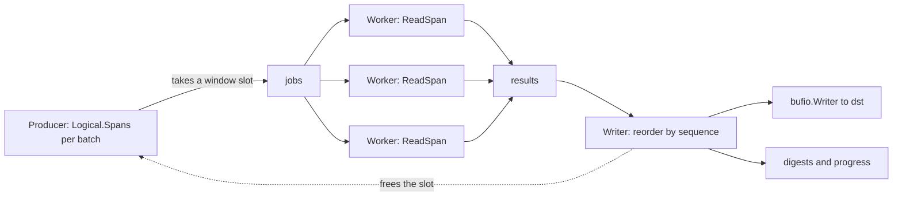

# Restore LLD

This document describes how DUES reads stored content back, and how `dues restore` writes it to a file. It is for developers who change the read path, the restore pipeline or the restore command.

The read path has three layers:

1. **The logical reader** (`lib/dbio/logical.go`) turns a record into an ordered list of chunk spans and reads them. It checks every chunk against its hash.
2. **Restore** (`lib/store/restore.go`) reads those spans in parallel and writes them in order to an `io.Writer`. It can also check the whole object against the hash its record carries.
3. **The command** (`cli/cmdrestore.go`) owns the target file. It writes a temporary file and renames it into place only after a successful restore.

IDs, hashes and hash lookups are described in [`UUID_HASH_DESIGN_DECISIONS.md`](UUID_HASH_DESIGN_DECISIONS.md).

## Source map

| File | Holds |
| --- | --- |
| `lib/dbio/logical.go` | `EvidenceChunks`, `Logical`, `ChunkSpan`, the chunk cache, `EvidenceChunkSize` |
| `lib/dbio/extents.go` | `ExtentReader`: extents with holes |
| `lib/dbio/intersect.go` | `Intersect`, `ErrChunkRange` |
| `lib/dbio/locator.go` | `LocateChunk`: where a chunk's bytes are |
| `lib/dbio/objects.go` | `OpenObjectChunks`: materialised objects |
| `lib/dbio/recordref.go` | `RecordEvidenceID`, `RecordPath` |
| `lib/dbio/dbio.go` | `GuessFileType`, `GuessFileTypes`: hash or ID to record key |
| `lib/store/restore.go` | `Restore`, the pipeline, the whole-object check |
| `cli/cmdrestore.go` | `RestoreData`, `restoreToPath`: target checks and output |
| `lib/fsx/fsx.go` | `WriteAtomic`: temporary file, sync, rename |
| `cli_defs.go`, `config_apply.go`, `internal/appconfig` | restore flags and tuning |

## Keys on the read path

- `E|||:<id>`, `P|||:<id>`, `I|||:<id>`: evidence, partition and indexed-file records.
- `R|||:<id>|||<offset>`: the hash of the chunk at that offset of evidence or object `<id>`. The offset is decimal. The value is zstd-compressed outside quick mode.
- `C|||:<chunk hash>`: where the chunk is stored (`structs.ChonkMetadata`: path, container offset, sizes).
- `X|||:<id>`: a materialised object (`structs.ObjectRecord`).
- `XE|||:<id>|||<page>`: extent pages of a very fragmented indexed file.

## The logical reader

### Evidence chunks

`OpenEvidenceChunks(db, eid, ReadOptions)` opens an evidence through its stored chunks. `eid` is the record key (`E|||:…`) or the raw ID.

- The record's `Start` and `Size` must describe a valid range.
- The chunk size comes from `EvidenceChunkSize` (see [Per-evidence chunk size](#per-evidence-chunk-size)).
- `Spans(ctx, start, end, batch, fn)` calls `fn` with the spans that make up `[start, end)`, in order, at most `batch` at a time.
  - Each batch reads its relations and chunk locations in one short read transaction.
  - A missing relation is `ErrRelationMissing`. A chunk with no location is `ErrChunkNotFound`.
  - `Intersect` trims each chunk to the range. Its bounds always lie inside the chunk, or it returns `ErrChunkRange`.
  - A range outside the evidence is `ErrChunkRange`.
- `ReadSpan(s)` returns a span's bytes:
  1. It takes the decoded chunk from the cache, or reads the blob or container record and decodes it.
  2. It checks the chunk against its hash (see [Verification](#verification)).
  3. It checks the chunk's length. Every chunk is the evidence's chunk size, except a shorter last one. Any other length is `ErrChunkRange`, so a chunk read from the wrong place never gives a short or long read.
  4. It returns `chunk[Lo:Hi]`. The bytes may be shared and must not be modified.
- `ReadAt` implements `io.ReaderAt` over evidence offsets.
- An `EvidenceChunks` is safe for concurrent use.

A `ChunkSpan` is one piece of a range: bytes `Lo:Hi` of the chunk at evidence offset `Chunk`, placed at `Offset` in the caller's coordinates. It carries the chunk's `Hash` and its location `Loc`.

### Verification

Every chunk read is checked against its hash unless `ReadOptions.SkipVerify` is set.

- **v2 codec.** The v2 `Decode` in `lib/blobcodec` always checks the plaintext against the chunk hash, so the reader does not hash again. `SkipVerify` has no effect on a v2 database.
- **Older codecs** (`legacy-sealed`, `legacy-raw`). Nothing in the stored payload ties it to its chunk. The reader hashes the decoded bytes with `blobcodec.Verify`, unless `SkipVerify` is set.
- A chunk that does not match is a `*dbio.ChunkCorruptError` with `EvidenceID`, `Offset`, `Hash` and `Path`. It matches `blobcodec.ErrCorrupt` through `errors.Is`.

### Chunk cache

- Each reader keeps decoded chunks in an LRU, keyed by chunk hash, within a byte budget.
- `ReadOptions.CacheBytes` sets the budget. Zero means `DefaultChunkCacheBytes` (64 MiB). A negative value keeps nothing.
- `ReadOptions.Cache` shares one cache, made by `NewChunkCache(budget)`, between readers. Search does this, because an evidence, its partition and the small files in one chunk all read that chunk.
- A chunk enters the cache only after it decoded and, unless `SkipVerify` is set, matched its hash. A chunk larger than the budget is never cached.
- Content is fixed for a hash, so entries never go stale. A repeated chunk, such as a run of zeros, is decoded once per reader.

### Logical objects

`OpenLogical(db, fid, ReadOptions)` opens a record by its key: `E|||:`, `P|||:` or `I|||:`. Any other prefix is `cnst.ErrUnknownFileType`.

| Record | What it reads |
| --- | --- |
| Evidence | its own chunks, `[Start, Start+Size)` |
| Partition | the range `[Start, Start+Size)` of its evidence |
| Indexed file with no `Content` (older records) | the range `[Start, Start+Size)` of its evidence |
| Indexed file, `extents` | evidence ranges in file order; sparse and unwritten extents read as zeros |
| Indexed file, `inline` | the bytes in the record, at most 16 KiB (`structs.MaxInlineBytes`) |
| Indexed file, `materialized` | the chunks of its object, at the object's own chunk size (`OpenObjectChunks`) |
| Indexed file, `none` | nothing: the file is empty |
| Indexed file, `unavailable` | nothing: `ErrContentUnavailable` (metadata only, or a symlink) |

- The evidence of a partition or indexed record comes from `RecordEvidenceID`: the record's `EvidenceID` field, or the older name form.
- `OpenLogical` checks the record before any byte is read:
  - a range must lie inside its evidence;
  - `Content.Located` must lie between 0 and the record's `Size`;
  - inline content must be `Located` bytes long, and `none` must locate 0 bytes;
  - extents must tile `[0, Located)` in order (`ErrBadExtents`), and data extents must lie inside the evidence;
  - an object must hold `Located` bytes.
- Extent pages are loaded at open for a file with more than `structs.MaxRecordExtents` extents.

Accessors:

- `Size()`: the bytes the reader serves. For a file whose content was only partly located, this is `Content.Located`. Nothing past it is filled in.
- `RecordedSize()`: the size the record gives. `Truncated()` reports `Size() < RecordedSize()`.
- `ChunkSize()`: the chunk size of the stored content the object reads.
- `FileHash()`: the record's hash (base64), or "".
- `Completed()`: whether the evidence finished ingesting.
- `Key()`, `Evidence()`.

Reading:

- `Spans(ctx, batch, fn)` gives spans in the object's coordinates.
  - A hole is a run of `Zero` spans, each at most one chunk long, so a reader never holds more of a hole than of data.
  - Inline content is one span with `Inline` set.
  - `ChunkSpan.Stored()` is false for both kinds. They have no `Hash` or `Loc`.
- `ReadSpan(s)` reads a span of any kind.
- `ReadAt` reads at file offsets. Extents files read through `ExtentReader`.
- `Stream(ctx, fn)` calls `fn` with the content in order. It batches by `SpanBatch(chunkSize)`, which is `clamp(256 MiB / chunk size, 4, 128)`.
- `StreamLogicalFileBytes(fid, db, fn)` is a wrapper around `OpenLogical(...).Stream`.

Restore, search, NeAR, full-text indexing, enrichment, `micro`, `reindex`, the `repair --upgrade` quarantine and the compression product all read stored content through this API.

### Per-evidence chunk size

`EvidenceChunkSize(db, rid, end)` returns the chunk size an evidence was stored with. The read path never uses the process-wide chunk size setting, because one database may hold evidence stored at different sizes (RST-2).

- A database created with a manifest uses one chunk size for every evidence: the manifest's (`dbmeta.UniformChunkSize`).
- In an older database, the size is read from the evidence's own relation keys. See [Older databases](#older-databases).
- A materialised object uses the `ChunkSize` in its `ObjectRecord`.

`lib/store/layout_guard_test.go` fails if a listed storage or read-path file reads `cnst.ChonkSize`, `cnst.QUICKOPT` or `cnst.HASHALGO`.

## Restore

### API

```go
func Restore(ctx context.Context, db *badger.DB, rhash string, dst io.Writer,
	opts RestoreOptions) (RestoreReport, error)

type RestoreOptions struct {
	Verify    VerifyLevel // VerifyFull (the zero value), VerifyChunks, VerifyOff
	VerifyEWF bool
}
```

`Restore` runs these steps:

1. It resolves `rhash` (base64) to a record key with `dbio.GuessFileType`. `rhash` may be a record ID or a file hash. A hash that several records share resolves to the evidence first, then an indexed file, then a partition. A hash that names no record or file hash is tried as an evidence's content root (the root lookup), so a sync or async evidence restores by its root too. A hash that names nothing fails with "no stored object has hash …".
2. It opens the record with `OpenLogical`. `SkipVerify` is set only for `VerifyOff`.
3. It refuses a record whose evidence is not COMPLETED, with `cnst.ErrIncompleteFile`.
4. With `VerifyEWF`, it prepares the EWF check for an evidence record whose EWF set recorded an MD5 or SHA-1. Any other record ignores `VerifyEWF`.
5. It runs the pipeline and returns a `RestoreReport`.

After any error, `dst` holds a partial write. The caller must discard it. The CLI does.

### Verification levels

| `--verify` | `VerifyLevel` | Each chunk | Whole object |
| --- | --- | --- | --- |
| `full` (default) | `VerifyFull` | checked | compared with `FileHash` |
| `chunks` | `VerifyChunks` | checked | not checked (`DigestSkipped`) |
| `off` | `VerifyOff` | checked only by the v2 codec | not checked (`DigestSkipped`) |

Every level checks each chunk's length and the total byte count.

### Whole-object check

At `full`, the writer passes every written span to a `digester`. In one pass, the digester computes each form a record's hash can take:

| Form | `DigestForm` | Computed as | Held by |
| --- | --- | --- | --- |
| plain | `blake3`, `sha3-256` | the file hash of the content | sync and async evidence; every partition, indexed file and object |
| hocho | `hocho-blake3`, `hocho-sha3-256` | the content root over the chunk hashes | hocho evidence |
| hocho with edges | `hocho-edges-blake3`, `hocho-edges-sha3-256` | the content root, but a partly covered or short chunk contributes the hash of its covered bytes | some older partition and indexed records |

- The chunk hash length selects the file hash: 32 bytes is BLAKE3, 64 bytes (SHA3-512) is SHA3-256. An unknown length tries both.
- Holes and inline bytes feed only the plain form. Only indexed files have them, and their hash is plain.
- `FileHash` must decode to 32 bytes. Otherwise the result is `DigestUnavailable`, and the restore still succeeds.
- A match gives `DigestVerified` and the form's name. No match is `ErrDigestMismatch`: every chunk matched its own hash, so the record's relations or range are wrong.

The content root is defined in [`UUID_HASH_DESIGN_DECISIONS.md`](UUID_HASH_DESIGN_DECISIONS.md#content-root).

### EWF check

- An EWF set is stored decoded, so its evidence restores as the decoded image.
- With `VerifyEWF`, the writer computes MD5 and SHA-1 over everything it writes. It compares them with `Source.EWF.StoredMD5` and `StoredSHA1`.
- `RestoreReport.EWF` is `verified` or `mismatch` (`structs.EWFVerified`, `structs.EWFMismatch`), or empty when nothing was checked.
- A mismatch is not an error. The restored bytes are what the set holds, but they differ from what the imager hashed.

### Pipeline



- **Producer.** It calls `Logical.Spans` with the batch size. Inside a batch it orders spans by container (`containerLocalityOrder`): the spans of each container go together, then the spans outside containers. A batch that touches at most one container keeps its order. Each job keeps its sequence number, so the write order never changes.
- **Window.** The producer takes a slot before it sends each job. The writer frees the slot once that chunk is written. So at most the window's worth of chunks is between lookup and write (RST-5).
  - The window is twice the batch. The producer sends a batch in container order, so the next chunk to write may be the batch's last. A window smaller than a batch could stall.
- **Workers.** Each worker calls `Logical.ReadSpan` (decode, verify, trim) and sends the result.
- **Writer.** It runs on the caller's goroutine.
  - It writes the next sequence number as soon as it arrives, parks later ones in a map, and drains the map as gaps close.
  - For each written span it updates the digests and the EWF hashes, and frees a slot.
  - It adds each written span to the `restore` phase (`internal/progress`); the display samples it on its own.
- **End checks.** After the results drain, `Restore` fails if ctx ended, a worker or the producer failed, the written chunk count differs from the count produced, or the written byte count differs from `Size()`. Then it flushes the buffer and evaluates the digests.
- **Container read cache.** It is enabled for the run. It serves only older compressed containers (see [Older databases](#older-databases)).

`restoreWindow` sets `batch = clamp(256 MiB / chunk size, 4, 128)` and `window = 2 × batch`:

| Chunk size | Batch (chunks per transaction) | Window (chunks) | Decoded bytes in the window |
| --- | --- | --- | --- |
| 256 KiB (default) | 128 | 256 | 64 MiB |
| 1 MiB | 128 | 256 | 256 MiB |
| 4 MiB | 64 | 128 | 512 MiB |
| 64 MiB | 4 | 8 | 512 MiB |

### Cancellation and errors

- A cancelled ctx closes the pipeline's `done` channel through `context.AfterFunc`. The producer and workers stop, and `Restore` returns the ctx error.
- The first worker or write error also closes `done`. Later results are drained and dropped. `Restore` returns the first error.

| Error | Cause |
| --- | --- |
| `badger.ErrKeyNotFound` | no record has that ID or hash |
| `cnst.ErrIncompleteFile` | the evidence has not finished ingesting |
| `dbio.ErrContentUnavailable` | the record holds no readable content |
| `*dbio.ChunkCorruptError` | a chunk does not match its hash |
| `dbio.ErrRelationMissing` | no relation at a chunk offset |
| `dbio.ErrChunkNotFound` | no location for a chunk |
| `dbio.ErrChunkRange`, `dbio.ErrBadExtents` | a chunk or a record does not fit the layout |
| `store.ErrDigestMismatch` | every chunk matched, but the whole object did not |

### `RestoreReport`

| Field | Meaning |
| --- | --- |
| `Key` | the restored record's key |
| `Size` | bytes written |
| `RecordedSize` | the size the record gives |
| `Truncated` | `Size < RecordedSize`: only part of the content was located |
| `Chunks` | spans written, hole and inline spans included |
| `Digest` | `verified`, `unavailable` or `skipped` |
| `DigestForm` | the form that matched, such as `blake3` or `hocho-sha3-256` |
| `EWF` | `verified`, `mismatch`, or empty |

## The `dues restore` command

```
dues restore HASH [--filepath|-f restored] [--force] [--verify full|chunks|off] [--verify-ewf]
    [--restore-workers|-y N] [--restore-queue|-U N]
    [--restore-buffer-mb|-b N] [global options]
```

`HASH` is the base64 of a record ID, a file hash or an evidence's content root, as `dues list` prints them.

| Flag | Default | Meaning |
| --- | --- | --- |
| `-f`, `--filepath` | `restored` | the target file |
| `--force` | off | replace an existing file |
| `--verify` | `full` | the verification level |
| `--verify-ewf` | off | check an EWF evidence against its stored MD5 and SHA-1 |
| `-y`, `--restore-workers` | 0 (automatic) | worker count |
| `-U`, `--restore-queue` | 0 (automatic) | job and result queue depth |
| `-b`, `--restore-buffer-mb` | 0 (automatic) | output buffer: 0 means 256 MiB, or 32 MiB in low-resource mode; at most 256 |

`-m`, `--restore-progress-ms` is retired: it is hidden, has no effect, and draws a warning.

### Output policy

`RestoreData` and `restoreToPath` (`cli/cmdrestore.go`) own the target:

1. **Check the target first**, before the database opens, so a refusal costs nothing. A directory is refused. An existing file is refused unless `--force` is given. Both refusals are usage errors.
2. **Open the database read-only** (`dbopen.ReadOnly`).
3. **Remove stale temporary files** of this target: `.<name>.dues-tmp-*` in the target's directory. Only a killed restore leaves them. No other file is removed.
4. **Write a temporary file** beside the target, `.<name>.dues-tmp-<random>`, through `fsx.WriteAtomic`. `store.Restore` writes into it.
5. **Sync, close and rename.** The rename replaces the target only with `--force`.
   - Without `--force`, the rename itself fails if the target exists. A file that appeared during the restore is therefore kept, and the command reports a usage error: `<path> was created while restoring; pass --force to replace it`.
   - Windows: `MoveFileEx` with `MOVEFILE_WRITE_THROUGH`, plus `MOVEFILE_REPLACE_EXISTING` under `--force`. A rename that another process blocks (antivirus, an indexer) is retried for up to 2 s.
   - Unix: without `--force`, a hard link to the target and then removal of the temporary file; with it, `rename`. A filesystem without hard links falls back to a check and a rename. The directory is synced afterwards.
6. **On any failure or cancellation**, the temporary file is removed and the target is left as it was.

The command never reads, renames or deletes `<target>.bak`, or any file other than the target and its own temporary files (RST-4).

### Messages and exit codes

After a successful restore the command prints one verification line:

- `Verified: N chunks match their hashes, and the content matches its recorded <form> hash.`
- `Verified: N chunks match their hashes. The record carries no hash of the whole content to check.`
- `Not verified against the recorded hash (--verify).` After an EWF match, this line adds `The image matches the MD5/SHA-1 its EWF set recorded.`

A truncated file or an EWF mismatch then prints a `Warning:` line.

| Exit | When | Target |
| --- | --- | --- |
| 0 | restored | written |
| 1 | the restore failed: unknown hash, incomplete evidence, corrupt chunk, digest mismatch, I/O error | unchanged |
| 2 | a bad flag value, or the target exists or is a directory | unchanged |
| 2 | restored with a warning: truncated content, or an EWF mismatch (`lifecycle.WarningError`) | written |
| 130, 143 | stopped by SIGINT or SIGTERM | unchanged |

### Other callers

- **TUI.** `tuiActions.restore` calls `restoreToPath` at full verification. It replaces an existing file only after the user agrees; otherwise it returns `tui.ErrTargetExists`. A warning sets `Outcome.Warning`.
- **Compression product.** Extraction calls `store.Restore` with `VerifyFull` (`internal/products/compression_product/duesarc.go`).

### Tuning

- Workers default to the CPU count, halved in low-resource mode and clamped to 2–16. The queue defaults to 4 × workers (`cnst.DefaultRestoreTuning`).
- `internal/appconfig` range-checks explicit values (workers up to max(64, 8 × CPUs), queue up to 65536) and checks them against an in-flight memory budget, in the database's own chunk size (read from its manifest). A rejected value is a usage error.
- The reorder window bounds the decoded data in flight, whatever the queue depth.
- The container read cache gets `cnst.GetCacheLimit()`, at most 4 GiB.
- The TUI restores with the config file's `restore` settings, or the defaults: it has no tuning flags.

## Older databases

These paths read data that earlier releases wrote:

- **Chunk size.** In a database written before manifests existed, its manifest is inferred at open, and evidence may differ in chunk size. `EvidenceChunkSize` then reads each evidence's size from its relation keys:
  - Every relation offset is a multiple of the chunk size s, and s is the smallest positive offset that has a relation.
  - So for any positive offset o that has a relation, s is the smallest divisor of o that also has one.
  - o is the database's chunk size if a relation exists there, else the gcd of up to 64 offsets from a key-only scan.
  - This costs a few point reads. The result is cached per data root and evidence, for up to 4096 entries.
- **Single-range records.** Partition records, and indexed records with no `Content` field, are the range `[Start, Start+Size)` of their evidence. Older records name their evidence only in `Name`. `RecordEvidenceID` parses it.
- **Edge-form hashes.** Older releases could hash partitions and indexed files from their relations. Those records hold the hocho-with-edges form, which `full` verification accepts.
- **Older codecs.** `legacy-sealed` and `legacy-raw` payloads carry nothing that ties them to their chunk. The reader's own hash check is what catches a substituted blob, so `--verify off` checks no chunk hash on these databases.
- **Block index.** In a database from the retired hierarchical mode (`cnst.LegacyBlockIndex`), `LocateChunk` looks up a chunk with no `C|||` entry in the block index.
- **Absolute blob paths.** `ResolveBlobPath` maps an absolute recorded path to the file of that name in this database's blob directory. It never uses the recorded location.
- **Compressed containers.** Quick mode once compressed whole containers into `<name>.blob.zst`, which cannot be read at an offset. While a restore runs, the container read cache decodes each one once: into memory within its budget, otherwise into a temporary file that is deleted on close.

## Tests

| Test | File | Covers |
| --- | --- | --- |
| `TestLogicalReadAt` | `lib/store/restore_verify_test.go` | reads at chunk edges, past the end, and streamed |
| `TestRestoreUsesEachEvidenceChunkSize` | `lib/store/restore_verify_test.go` | evidence at different chunk sizes in one database |
| `TestRestoreRejectsSubstitutedChunk`, `TestRestoreVerifiesRecordedHash` | `lib/store/restore_verify_test.go` | chunk checks, and every whole-object form |
| `TestRestoreReorderWindowIsBounded` | `lib/store/restore_window_test.go` | the reorder window |
| `TestReaderContentKinds`, `TestReaderServesFixtures` | `lib/index/reader_test.go` | every content kind; every fixture; an E01 checked against its stored digests |
| `TestRestoreLogicalRangeAcrossChunkBoundaries` | `cli/restore_range_test.go` | ranges across chunk boundaries, in every storage mode |
| `TestRestoreTargetSafety` | `cli/restore_target_test.go` | target refusal, `--force`, a sibling `.bak`, directories, cancellation |
